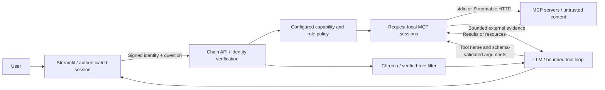

# MCP support

The Blueprint acts as an MCP host/client. Its chain service connects to explicitly configured MCP servers, exposes permitted tools and static resources to the answer model, and combines their results with Chroma document retrieval. It does not expose the Blueprint as an MCP server.

MCP is disabled by default. The existing `/call_llm` behavior is retained when `use_mcp` is omitted or false. An MCP-enabled request requires a model with OpenAI-compatible tool calling, a configured identity secret, and a valid frontend assertion. Connection or tool failures are recorded as partial failures; there is no automatic downgrade of identity checks.

## What changed (branch `feat/mcp-integration`)

MCP integration (new, opt-in):

- `/call_llm` accepts `"use_mcp": true`. That request goes to a separate async execution path (`call_mcp_endpoint` in `chain/chain_api.py`); the legacy chain is unchanged.
- New package `chain/mcp_integration/` handles configuration, identity verification, request-local MCP client sessions, the bounded tool loop and a final document-permission filter.
- The frontend signs the logged-in user's identity (`frontend/authentication/mcp_identity.py`). It also adds a **Use MCP servers** sidebar toggle and an **MCP activity for the last answer** panel (`frontend/pages/rag_chat.py`, `frontend/api_calls.py`).
- A read-only demo MCP server (`chain/mcp_demo/server.py`), an example configuration (`chain/mcp_servers.example.json`) and a Compose override with an `mcp` profile (`docker-compose.mcp.yml`).
- `ensure_input_allowed(..., fail_closed=True)` lets the MCP path block input when the guardrail check itself fails. The legacy path still fails open.
- New dependencies: `mcp==1.29.1` and `jsonschema==4.26.0` (`chain/requirements.txt`).
- New environment variables: `MCP_ENABLED`, `MCP_CONFIG_FILE`, `MCP_IDENTITY_SECRET` (`example.env`).
- Tests: `chain/tests/test_mcp_integration.py`.

General fixes on the same branch (they also affect non-MCP use):

- `LLM_TEMPERATURE` (default `0`) configures the sampling temperature. Set it empty to omit the parameter for models that reject it (`chain/handle_llms.py`).
- Model and retrieval settings are read per request, not once at import, so an in-process caller (e.g. a benchmark) can change them between requests: `MODEL_NAME` (`chain/handle_llms.py`), new `EMBEDDING_MODEL` (default `nomic-embed-text`; `chain/retriever.py` and `loader/vector_store.py`) together with `OLLAMA_BASE_URL` and new `OLLAMA_API_KEY` (sent as Bearer token for Ollama behind an authenticating proxy), and new `RETRIEVER_TOP_K` (default `5`, legacy and MCP path). Defaults keep the previous behavior. Changing `EMBEDDING_MODEL` requires re-uploading all documents.
- MinIO now uses `cgr.dev/chainguard/minio`, because `minio/minio` is no longer available on Docker Hub. Its health check is `mc ready local`.

## Code map

| File | Responsibility |
| --- | --- |
| `chain/chain_api.py` (`call_mcp_endpoint`) | Feature flag, identity check, input limits, prompt-key allowlist, guardrail (fail closed), overall deadline, HTTP error mapping |
| `chain/mcp_integration/config.py` | Pydantic schema for the admin JSON config (`extra="forbid"`), transport validation, limits |
| `chain/mcp_integration/identity.py` | Verifies the frontend HMAC assertion and returns `Identity(subject, roles)` |
| `chain/mcp_integration/client_manager.py` | Opens one session per permitted server for each request, runs paginated discovery, registers allowlisted tools/resources under hashed aliases, validates arguments against JSON Schema, executes calls with timeouts and size limits, emits audit events |
| `chain/mcp_integration/execution.py` | RAG retrieval with verified roles, prompt assembly, bounded model/tool loop, response shaping |
| `chain/mcp_integration/policy.py` | Final deny-by-default document filter on role bitmasks |
| `frontend/authentication/mcp_identity.py` | Signs `{sub, roles, aud, iat, exp}` for the logged-in Streamlit user |
| `chain/mcp_demo/server.py` | FastMCP demo server (`get_retention_policy`, `add`, resource `blueprint://policy/retention`, and a `slow_read` tool that isn't enabled by default) |

## Request flow

1. The user enables **Use MCP servers** and sends a question. The frontend signs the session identity (valid for 60 s) and posts to `/call_llm` with `use_mcp: true` and an `Authorization: Bearer <payload>.<hmac>` header.
2. The chain checks `MCP_ENABLED`, verifies the assertion, enforces input limits and the prompt-key allowlist, and loads a fresh config snapshot.
3. Everything below runs within `request_timeout_seconds`. The input guardrail runs first and blocks the input if the check itself fails.
4. The query is refined and documents are retrieved from Chroma using **signed** roles. `policy.permitted_documents` then removes every document the user doesn't fully hold the roles for.
5. `ClientManager.open()` connects only to servers whose `roles` intersect the user's roles. It discovers capabilities and registers only those named in `read_only_tools` / `resource_uris`. Resources become argument-less tools. A server that fails discovery is dropped as a whole.
6. The model is bound to these tools. Up to `max_rounds` times: the model answers or requests tool calls. Each call is looked up by alias, its arguments are schema-validated, it runs with a timeout, and its result is size-checked and returned as a `ToolMessage`. Errors go back to the model as structured errors. Once the budget is used up, the model must give a final answer without tools.
7. The response contains `result`, `relevant_documents` (documents plus MCP evidence), `prompt_key` and `mcp` (`request_id`, `events`, `sources`). The frontend shows `mcp` in the sidebar.

## Quick start with Docker

1. Configure `.env` as described in the main README, including your model endpoint. Generate a local secret with `python -c "import secrets; print(secrets.token_urlsafe(48))"` and put it in `MCP_IDENTITY_SECRET`. Do not commit the secret. The frontend and chain must receive the same value.
2. Start the optional demo profile:

   ```bash
   docker compose -f docker-compose.yml -f docker-compose.mcp.yml --profile mcp up --build
   ```

3. Log in as a user with `General` or `admin` among their assigned roles, upload a document, and enable **Use MCP servers** in the chat sidebar.
4. Ask: “Summarize my document and use the demo server to look up the document retention policy.” The synthetic policy says **30 days**. The selected model decides whether tools are needed; inspect **MCP activity for the last answer** to verify actual calls.

The override enables MCP in the frontend and chain and starts a read-only demo container on the internal Docker network. It does not publish the demo port to the host. To disable MCP again, start with only the base Compose file and leave `MCP_ENABLED=false` in `.env`.

## Configuration

`MCP_ENABLED=true` enables the feature. `MCP_CONFIG_FILE` points to an administrator-owned JSON file; `chain/mcp_servers.example.json` is a complete example. The chain reloads it for each MCP request; each request keeps its validated snapshot. Restrict write access to this file as tightly as application code. The base Compose configuration mounts `./chain` into `/app`, so a file inside `chain/` is available there.

Remote server example:

```json
{
  "servers": [{
    "id": "policies",
    "transport": "streamable_http",
    "url": "https://policies.internal.example/mcp",
    "bearer_token_env": "POLICY_MCP_TOKEN",
    "roles": ["Legal & Compliance"],
    "read_only_tools": ["search_policies"],
    "resource_uris": ["policy://handbook"]
  }]
}
```

The exact configured URL is the network allowlist entry. Request bodies and model outputs cannot specify servers, URLs, commands or credentials. TLS verification is enabled, redirects and environment-derived HTTP proxies are disabled. HTTP requires explicit `allow_plain_http: true`, intended for local/on-premises test networks. Deployments must enforce DNS and network egress policy for approved hosts, including restrictions on cloud metadata access. Approved on-premises servers may legitimately use private addresses; there is no blanket private-address block.

Local subprocess example (adjust the executable and path to your installation):

```json
{
  "servers": [{
    "id": "localdemo",
    "transport": "stdio",
    "command": "/usr/local/bin/python",
    "args": ["/app/mcp_demo/server.py", "--stdio"],
    "roles": ["General"],
    "read_only_tools": ["get_retention_policy", "add"],
    "resource_uris": ["blueprint://policy/retention"],
    "env": {}
  }]
}
```

Commands require absolute paths and use argument arrays without a shell. `env` maps child variable names to host environment variable names, for example `{"API_TOKEN": "LOCAL_SERVER_TOKEN"}`. The SDK also supplies its small platform-default environment; the host's full environment is not forwarded. Subprocess stderr is discarded to prevent untrusted payloads/secrets entering host logs. Only install administrator-reviewed server packages; there is no automatic package download. A subprocess runs with the chain process's filesystem and OS privileges, **not** in a sandbox. Prefer separate containers for servers outside the host's trust boundary. The existing base Compose file runs the chain as root; that also applies to stdio children unless deployment configuration is changed.

Roles are exact, case-sensitive names. Empty role/capability lists deny access. Tools are exposed only when named in `read_only_tools`; this is an administrator's review/attestation, not a guarantee the server implementation cannot mutate data. Server annotations cannot grant permissions. Resources require exact discovered URIs; resource templates and arbitrary URI reads are not supported.

Tool aliases contain the server ID, a sanitized label, and a hash. Tool arguments are validated locally against the discovered JSON Schema before execution. Schemas containing `$ref` are rejected, including local references, to avoid remote resolution and recursive schemas in this initial implementation. Discovery is bounded and paginated. Unsupported/malformed catalogs make that server unavailable for the request.

Default limits:

| Setting | Default | Purpose |
| --- | ---: | --- |
| `timeout_seconds` | 15 | Initialization, discovery page and operation timeout |
| `request_timeout_seconds` | 90 | Overall MCP answer deadline |
| `max_rounds` | 4 | Model/tool rounds before final answer without tools |
| `max_calls` | 8 | Total attempted calls, including denied/invalid calls |
| `max_result_bytes` | 16000 | Serialized argument/result size accepted by the host |
| `max_catalog_bytes` | 128000 | Maximum serialized discovery page size |
| `max_capabilities` | 64 | Entries per discovery catalog / total exposed capabilities |
| `max_pages` | 8 | Maximum pages per discovery catalog |

Only text and structured results are forwarded. Images, binary resources, embedded resource links and other non-text blocks are not fetched or expanded. Result limits apply **after SDK decoding**; they are not wire-level memory protection against a malicious server. Use process/container memory limits and network controls for adversarial servers. Each tool result is bounded; the total result context is also bounded by the call budget. Retrieved document context and chat history are capped in the MCP prompt.

## Identity and API contract

The Streamlit frontend signs the authenticated session's username and roles using HMAC-SHA256 and `MCP_IDENTITY_SECRET` (at least 32 characters). Assertions last 60 seconds, have audience `rag-mcp`, and are sent as a Bearer Authorization header. The chain verifies signature, audience and timestamps; MCP permissions and document retrieval use **signed roles**, ignoring `user_roles` from the request body. The frontend is a trusted issuer: possession of its signing secret allows impersonation. Use TLS between services outside a trusted local network and keep this secret out of browsers and MCP server environments.

The existing frontend login system remains the identity source; this is not an enterprise identity-provider integration. Assertions may be replayed until expiry; there is no replay database or instant revocation. The MCP path does not repair the legacy non-MCP endpoints' caller-supplied roles or authentication. Direct API integrations need a trusted issuer of the same assertions; never embed the shared signing secret in a public client.

The MCP path also applies a final document-permission check after retrieval: non-admin users must hold every role bit on a document. Missing, zero, malformed or unknown tags are denied. This prevents the legacy retriever's unfiltered `General`/fallback behavior or `RETRIEVER_DISABLE_FILTER` from leaking documents into MCP prompts or source responses. Existing retrieval may still under-return documents because of its exact-bitmask search; the final check prioritizes access control and does not change legacy retrieval semantics.

Send the existing `/call_llm` payload with `"use_mcp": true` and the assertion header. Chat prompt keys `rag_source`, `rag_summary`, and `rag_weekly_report` are supported. The existing response keys remain; the additive `mcp` object contains a request ID, operation events and successful source identifiers. MCP evidence is also included in `relevant_documents` when sources are requested, so the existing answer checker receives it. Source identifiers indicate evidence supplied to the model, not proof the model actually relied on it.

Status codes: 400 input blocked by guardrails, including when the guardrail check itself fails (fail closed); 401 invalid identity; 422 unsupported or invalid prompt key, or question longer than 16,000 characters / more than 100 history messages; 503 disabled/misconfigured feature; 504 overall deadline; 502 model/tool-protocol or RAG failure. An unexpected 400 often means the guardrail model call failed, for example because the model rejects `temperature`; see `LLM_TEMPERATURE` in the main README. Individual server/tool failures appear in `mcp.events` and are supplied to the model without raw exception details. There are no automatic tool retries. MCP input guardrails fail closed on inference failure unless the administrator explicitly sets `DISABLE_GUARDRAILS=true`. Legacy behavior is unchanged.

## Architecture and research handoff



Trust boundaries for the thesis:

1. Browser input and chat history → authenticated frontend → signed backend identity.
2. Administrator configuration and credentials → network destinations / subprocess execution.
3. Server capability descriptions and schemas → model-visible tool catalog.
4. Model-generated tool calls → host permission lookup and schema validation.
5. External resource/tool content and retrieved documents → model context and answer.
6. Answers, source content and operation metadata → frontend and existing answer checkers.

`rag.mcp` emits structured operation events containing request ID, server ID, capability alias, outcome and call duration. Arguments, results, usernames, tokens, URLs and raw exceptions are omitted. Standard application log-level configuration must enable INFO to collect successful events. This implementation deliberately has no payload-capture mode; use synthetic fixtures and a separately reviewed research harness when full payloads are needed.

Research scenarios include tool-description/result prompt injection, excessive tool calls, role escalation attempts, resource URI manipulation, broken pagination, slow/unavailable servers, oversized results, malicious stdio processes and cross-request isolation. Prompt instructions label external content as untrusted, but are **not** a prompt-injection security guarantee. Host permissions and limits apply regardless of what the model requests. Server-side authorization, OAuth/credential lifecycle, DNS rebinding, transport memory exhaustion, legacy authentication and chain container privileges remain deployment/research considerations.

## Validation

Run from the repository root after installing `chain/requirements.txt` and `requirements-test.txt`:

```bash
python -m pytest chain/tests/test_mcp_integration.py -q -o addopts=''
```

The suite exercises real stdio and local Streamable HTTP servers, schema/role denials, timeouts, concurrent sessions, pagination limits, identity tampering/expiry, and a complete document-plus-MCP answer using a scripted tool-calling model. It needs permission to bind a local test port, but no internet, Docker, live model or vector database. Test dependency versions are pinned for the MCP SDK and JSON Schema validator; existing project dependencies remain as specified by the Blueprint.

To run the whole chain suite: `python -m pytest chain/tests -q -o addopts=''`. If your local `.env` is loaded into the test process, tests that depend on environment variables pin them explicitly (for example `LLM_TEMPERATURE`).

## Adding a new MCP server

1. Deploy or install the server. Prefer a separate container on `rag_network` over stdio for anything you don't fully trust.
2. Add an entry to the file referenced by `MCP_CONFIG_FILE`. Give it a unique lowercase `id`, the exact `url` (or an absolute `command`), the `roles` that may use it, and the reviewed `read_only_tools` / `resource_uris`. Put tokens in environment variables and reference them via `bearer_token_env` / `env`. Never put them in the JSON.
3. No restart is needed; the file is re-read for each MCP request. If it's invalid, MCP requests return 503 (`mcp_configuration_invalid` in the logs) until it's fixed.
4. Check that the tool shows up: ask a question that needs it and inspect **MCP activity for the last answer**. Events have the form `server / operation / status`. Typical ones are `discover ok`, `connect denied` (role mismatch), `discover unavailable` (connection, protocol or catalog error), `tool|resource ok|error|invalid_arguments|result_too_large|unavailable`, `call denied` (unknown alias) and `host … budget_exhausted`.
5. Add a test to `chain/tests/test_mcp_integration.py` if the server needs new host behavior.

## Troubleshooting

| Symptom | Likely cause |
| --- | --- |
| Sidebar toggle disabled | `MCP_ENABLED` isn't `true` in the **frontend** container |
| "MCP identity is not configured" / 503 *identity verification is not configured* | `MCP_IDENTITY_SECRET` missing or shorter than 32 characters in frontend or chain |
| 401 | Secrets differ between frontend and chain, clocks are skewed, or the user has no roles |
| 503 *MCP is disabled* | `MCP_ENABLED` isn't `true` in the **chain** container |
| 503 *configuration is invalid* | JSON syntax/schema error, unknown key, duplicate ID, non-HTTPS URL without `allow_plain_http`, relative stdio command |
| 400 for harmless input | The guardrail model call failed (fail closed). Often caused by `temperature`; try `LLM_TEMPERATURE=` |
| 502 *does not support MCP tool calling* | The model or endpoint has no OpenAI-compatible tool calling |
| Answer ignores the tool | No capabilities for this user (check `events`), or the model decided the tool wasn't needed |
| `discover: unavailable` | Server unreachable, wrong URL, TLS error, redirect, oversized catalog, or a schema containing `$ref` |

SDK reference: [official MCP Python SDK](https://github.com/modelcontextprotocol/python-sdk). Tool messages follow [LangChain's tool-call message protocol](https://docs.langchain.com/oss/python/langchain/messages).
